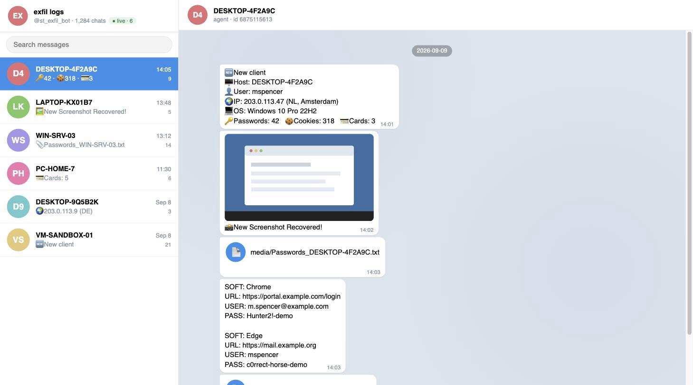

.. _malware-c2:

Analyzing a malware C2 / exfil bot
==================================

Malware often hard-codes a Telegram bot token as its **command-and-control or
exfiltration channel** — it is a free, reliable, TLS-encrypted transport that
blends into normal traffic. Recover that token from a sample, and this dumper
opens the operator's own bot like Telegram Web: you can read exactly what was
exfiltrated, laid out as ordinary chats.

Each infected host shows up as its own chat, and the messages are the stealer's
own reports: **victim fingerprints** (hostname, user, IP, OS), **stolen
credentials**, recovered **screenshots**, and uploaded **archives** of harvested
data.

Why the dumper helps here
-------------------------

- **One chat per victim.** The chat list *is* the victim list — count and
  enumerate infected hosts at a glance (see :doc:`output-layout </output-layout>`
  for the on-disk ``users.csv`` you can hand to responders).
- **The media is the loot.** Exfiltrated screenshots and archives are downloaded
  next to each chat's history, so you recover the actual stolen files, not just
  references to them.
- **Search across every victim at once.** Global search finds a leaked corporate
  domain, hostname, or credential across the whole botnet's output in one query.
- **Live mode catches fresh beacons.** With ``--listen-only`` you watch new
  victim check-ins arrive in real time while the token is still live — useful for
  scoping an active campaign.

A triage flow
-------------

#. Recover the token from the sample (config, strings, or captured traffic).
#. Enumerate victims cheaply first::

      ./dumper.py --token TOKEN --down --users-csv --no-photos --no-media --no-history

#. Full dump to pull down the exfiltrated media and history::

      ./dumper.py --token TOKEN --down

#. Browse and search the result in the :doc:`web viewer </web-viewer>`.

.. warning::
   Handle recovered malware output as evidence, in an isolated environment, and
   only under proper authorization. See the disclaimer on the
   :doc:`front page </index>`.

.. note::
   The screenshot above is a **synthetic** mock-up — a real dump holds actual
   victims' data, which must never ship in a public repo.
