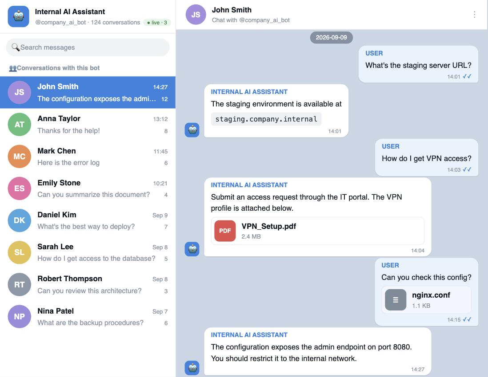

.. _pentesting:

Pentesting a leaked bot token
=============================

Telegram bot tokens turn up constantly on an engagement — hard-coded in a
mobile or desktop app, committed to a repo, or sitting in a CI log, a config
file, or a client-side bundle.

On its own a leaked token reads like a low-severity finding. Loading it into the
dumper and the :doc:`web viewer </web-viewer>` shows the **real blast radius**.

For an internal bot — a support desk, an IT/DevOps helper, an AI assistant —
that history is every employee conversation with it: internal hostnames, VPN
profiles, credentials, and infrastructure details, all browsable and searchable.
That is what lets you scope the impact and evidence the finding in a report.

A fast triage flow
------------------

#. **Enumerate the users first** — cheap, and it sizes the exposure:

   .. code-block:: sh

      ./dumper.py --token TOKEN --down --users-csv --no-photos --no-media --no-history

   Read ``<bot_id>/users.csv`` to see who has talked to the bot.

#. **Full dump** of what the token actually exposes:

   .. code-block:: sh

      ./dumper.py --token TOKEN --down

#. **Browse and search** the dump to find the sensitive material and screenshot
   it for the report:

   .. code-block:: sh

      docker run --rm -p 127.0.0.1:8010:8010 -v "$PWD:/data" soxoj/telegram-bot-dumper-web

.. warning::
   Only against a token you are **authorized** to assess. See the disclaimer on
   the :doc:`front page </index>`.

Where tokens leak
-----------------

A quick way to see the shape of the problem is a code search for common bot
libraries, e.g. `telepot.bot on GitHub
<https://github.com/search?q=telepot.bot&type=Code>`_.
