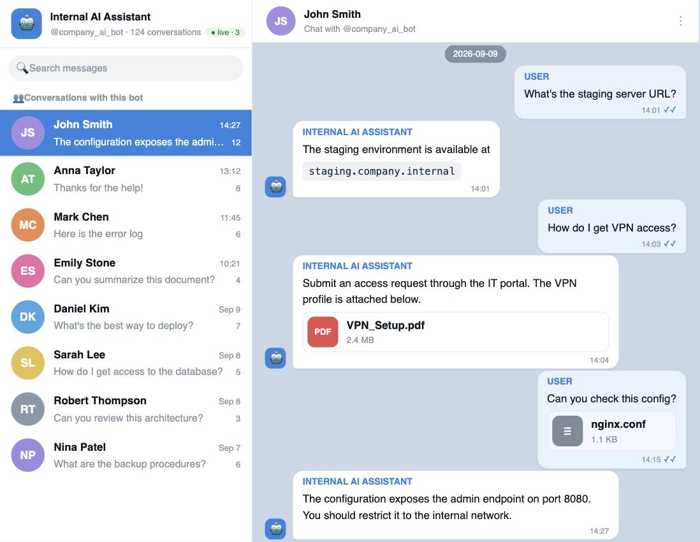

.. _web-viewer:

Web viewer
==========

A **Telegram-Web-like browser UI for a dump**: a chat list, full message history
with inline media, user profiles with a photo carousel, and global search across
every conversation at once.

**Live mode** is supported: the viewer runs the dumper in the background and
streams new messages into the browser in real time.

Read-only viewing is auth-free, local, and needs **no** API credentials — you
only need them for live capture.

Run from a prebuilt image (Docker Hub)
--------------------------------------

.. code-block:: sh

   docker run --rm -p 8010:8010 -v "$PWD:/data" soxoj/telegram-bot-dumper-web

Build locally
-------------

.. code-block:: sh

   docker compose up --build      # builds and serves on http://127.0.0.1:8010

Without Docker
--------------

.. code-block:: sh

   pip install -r requirements.txt
   python webapp/server.py        # serves the current directory's dumps on :8010

Open http://127.0.0.1:8010 and paste a bot token to pick its dump folder.

Live mode
---------

Live mode additionally needs ``API_ID`` / ``API_HASH`` from
`my.telegram.org <https://my.telegram.org>`_, passed **via the environment** —
never baked into the image:

.. code-block:: sh

   # one-off container
   docker run --rm -p 8010:8010 -v "$PWD:/data" \
     -e API_ID=123456 -e API_HASH=abc... soxoj/telegram-bot-dumper-web

   # or with docker compose: put them in a local .env (see .env.example)
   cp .env.example .env && $EDITOR .env && docker compose up

Configuration
-------------

.. list-table::
   :header-rows: 1
   :widths: 20 30 50

   * - Variable
     - Default
     - Effect
   * - ``PORT``
     - ``8010``
     - Port the viewer listens on.
   * - ``HOST``
     - ``127.0.0.1``
     - Bind address. Set ``0.0.0.0`` to expose it (the Docker image already does).
   * - ``API_ID`` / ``API_HASH``
     - *(unset)*
     - Telegram API credentials. Only needed for live capture; viewing an
       existing dump needs neither.
